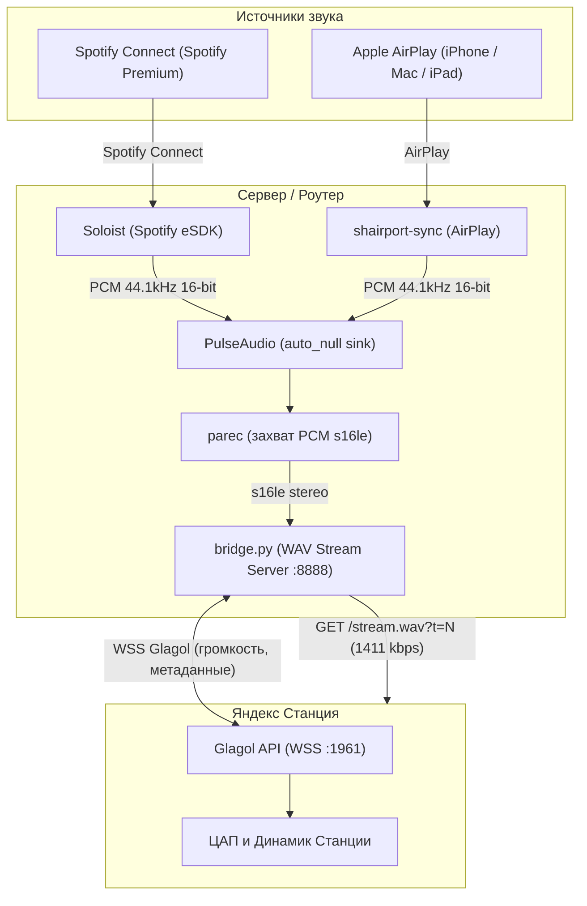

# 🎵 Alice Spotify & AirPlay Lossless Bridge

Беспроводной стриминг **Spotify Connect** и **Apple AirPlay** на любую **Яндекс Станцию** (с Алисой) по локальной сети в оригинальном качестве **Lossless WAV 1411.2 kbps (bit-perfect)**.

---

## ⚡️ Быстрый старт (установка одной командой)

Скрипт автоматически определит систему, установит все пакеты (PulseAudio, Shairport-Sync, Python), скачает компоненты моста, настроит автозапуск служб и запустит мастер настройки:

### На Ubuntu / Debian / Raspberry Pi OS:
```bash
curl -sSL https://raw.githubusercontent.com/konchul/alice-spotify-bridge/main/install.sh | sudo bash
```

### На роутере OpenWrt:
```bash
curl -sSL https://raw.githubusercontent.com/konchul/alice-spotify-bridge/main/install.sh | sh
```

---

## 🛠️ Что нужно для работы

1. **Подписка Spotify Premium**:
   * Для работы Spotify Connect на внешних аудиоустройствах (Spotify eSDK / Soloist) компания Spotify на уровне протокола требует активную подписку **Spotify Premium** (бесплатные аккаунты Connect на стороннем железе не поддерживаются).
   * Для воспроизведения через **Apple AirPlay** никакие подписки не нужны — передается любой звук с iPhone, iPad или Mac.
2. **Яндекс Станция**:
   * Любая модель (Станция 1/2, Макс, Миди, Мини 1/2, Лайт 1/2, ТВ Станции), подключенная к домашней Wi-Fi сети.
3. **Сервер или роутер (системные требования)**:
   * **Потребление оперативной памяти процессами (всего ~155 МБ RAM)**:
     * PulseAudio (минимальный headless-профиль): **~8.3 МБ** (вместо стандартных 750+ МБ)
     * Shairport-Sync (AirPlay эмулятор): **~7.7 МБ**
     * Parec (захват чистого PCM s16le): **~6 МБ**
     * Python Bridge (`bridge.py`): **~41 МБ**
     * Soloist (Spotify Connect eSDK): **~72 МБ** (+ crashpad ~21 МБ)
   * **Вариант А: ПК / Сервер / Raspberry Pi (Ubuntu / Debian / Raspberry Pi OS)**:
     * Диск: от **500 МБ** свободного места (для пакетов PulseAudio, Shairport-Sync и зависимостей Python).
     * Оперативная память: от **256–512 МБ** RAM (весь аудио-стек суммарно потребляет ~**155 МБ**).
   * **Вариант Б: Роутер с OpenWrt (x86_64 или aarch64)**:
     * USB-порт и флешка / SSD: от **2 ГБ** (архив Ubuntu rootfs занимает ~490 МБ, распакованный — ~950 МБ).
     * Оперативная память роутера: рекомендуется от **1–2 ГБ** RAM (так как chroot монтируется в скоростной RAM-диск `tmpfs`, чтобы не изнашивать флешку постоянной циклической перезаписью).

---

## 🔑 Как получить ключи и токены

Для работы моста нужны всего два параметра:

* **Яндекс `Session_id` (Cookie авторизации)**:
  * **1.** Войдите в аккаунт на [yandex.ru](https://yandex.ru) в браузере с компьютера.
  * **2.** Нажмите **F12** → вкладка **Application** (в Firefox — **Storage / Хранилище**) → слева **Cookies** → `https://yandex.ru`.
  * **3.** Скопируйте значение строки **`Session_id`** (начинается с `3:...`).
* **Spotify Developer API Key (`spak_...`)**:
  * Специальный ключ для протокола Spotify eSDK. Интерактивный мастер `setup.py` автоматически предложит готовый рабочий ключ, либо можно использовать свой из [Spotify Developer Dashboard](https://developer.spotify.com/dashboard).
* **Фиксация статического IP Станции**:
  * В веб-интерфейсе роутера (**DHCP** → **Static Leases**) обязательно закрепите IP-адрес Станции по её MAC-адресу (например, `192.168.1.102`), чтобы колонка не меняла адрес при перезагрузке.
* **Device ID и Platform Станции**:
  * Вручную искать не нужно: мастер `setup.py` (или команда `python3 bridge.py --list-devices`) сам опросит облако Яндекса по вашему `Session_id` и покажет пронумерованный список ваших колонок.

---

## 💎 Как это работает и почему такой качественный звук

Большинство решений используют **Bluetooth** (сжатие кодеками SBC/AAC с задержкой 2 сек и срезом частот выше 16 кГц) или перекодирование в **MP3** (двойная потеря качества и нагрузка на CPU).

В этом проекте перекодирование **полностью отсутствует (Bit-Perfect Lossless 1411.2 kbps)**:



### Преимущества звукового тракта:
* **Честный битрейт Audio CD**:
  $$\text{Битрейт} = 44\,100 \text{ Гц} \times 16 \text{ бит} \times 2 \text{ канала} = \mathbf{1411.2 \text{ кбит/с}}$$
* **Zero-Transcoding и работа без дискового I/O**: Звук из PulseAudio без перекодирования упаковывается в стандартный контейнер WAV (RIFF WAVE) и через кольцевой буфер в оперативной памяти напрямую отдаётся аппаратному декодеру Станции (никакой записи временных файлов на флешку или диск).
* **Сверхлегкий PulseAudio профиль**: отключены все тяжелые десктопные модули (BlueZ, udev-detect, gsettings), сократив потребление звукового сервера с 750 МБ до рекордных **8.3 МБ RAM**, а `avoid-resampling = yes` исключает нагрузку процессора на ресемплинг.
* **Полный диапазон**: 20 Гц – 20 000 Гц без артефактов компрессии и динамический диапазон 96 дБ.
* **Токенизация потока (`?t=N`)**: при переключении треков URL получает новый токен, заставляя плеер Станции мгновенно сбрасывать буфер без застревания старого звука.
* **Изоляция клиентов по IP**: при переподключении колонки старые зависшие TCP-сокеты мгновенно вытесняются.
* **Двусторонняя громкость**: физические кнопки/колесо Станции плавно двигают ползунок в приложении Spotify, и наоборот (с 3-секундным анти-эхо фильтром).
* **Автоприоритет**: запуск AirPlay автоматически ставит Spotify на паузу, и наоборот.

---

## 📊 Сравнение методов передачи звука

| Параметр | Bluetooth на Станцию | MP3-мост | **Этот проект (Lossless WAV)** |
| :--- | :--- | :--- | :--- |
| **Формат аудио** | SBC / AAC (сжатие) | MP3 192–320 kbps (сжатие) | **PCM WAV (Lossless, без потерь)** |
| **Реальный битрейт** | ~250–320 kbps | 192–320 kbps | **1411.2 kbps (Bit-Perfect CD Quality)** |
| **Повторное сжатие** | Да (двойное) | Да (mp3lame) | **Нет (0% потерь качества)** |
| **Частотный срез** | Срезано выше 16–17 кГц | Срезано выше 18 кГц | **Полные 20 Гц – 20 000 Гц** |
| **Задержка старта** | 1.5 – 3.0 сек | 2.0 – 4.0 сек | **< 0.35 сек (Pre-roll буфер 500 мс)** |
| **Громкость со Станции** | ❌ Не синхронизирует Spotify | ❌ В одну сторону | **✅ Двусторонняя (кнопки Станции ⇄ Spotify)** |
| **Отображение обложек** | ❌ Нет | ❌ Только текст | **✅ Название, Артист и Обложка трека** |
| **Нагрузка на процессор** | Средняя | Высокая | **Минимальная (< 2% CPU)** |

---

## 📄 Лицензия

Проект распространяется под свободной лицензией **MIT License**. Подробнее см. в файле [LICENSE](LICENSE).
