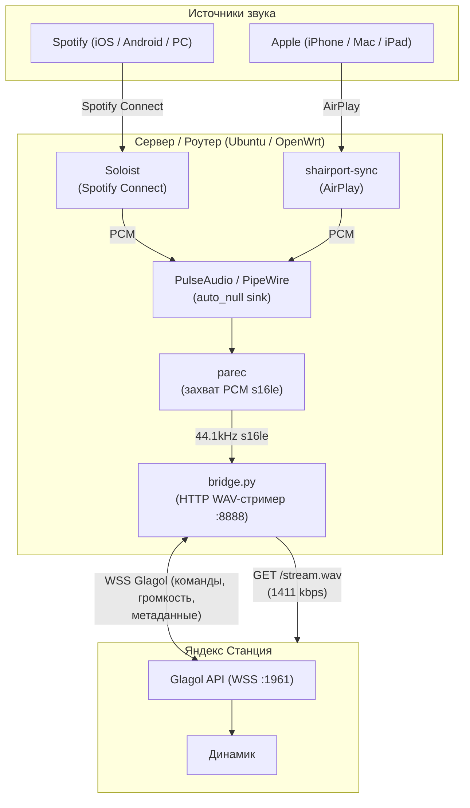

# 🎵 Alice Spotify & AirPlay Lossless Bridge

Стриминг **Spotify Connect** и **Apple AirPlay** на любую **Яндекс.Станцию** (с Алисой) по локальной сети в оригинальном качестве **Lossless WAV 1411 kbps (bit-perfect)**.

Поддерживает работу на **Ubuntu / Debian / Raspberry Pi** и на роутерах с **OpenWrt** (через легковесный chroot).

---

## ✨ Возможности

* 🎧 **Настоящий Lossless (1411.2 kbps, 44.1 кГц / 16-бит)**: Звук со Spotify и AirPlay не пережимается в MP3/AAC, а передается в колонку как чистый PCM/WAV без потерь качества.
* 📱 **Spotify Connect**: Колонка видна в официальном приложении Spotify на смартфонах (iOS / Android), ПК и планшетах.
* 🍏 **Apple AirPlay**: Поддержка беспроводного стриминга звука с iPhone, iPad и Mac.
* 🔊 **Двусторонняя регулировка громкости**: Изменение громкости на физических кнопках Станции моментально обновляет ползунок в приложении Spotify, и наоборот.
* 🖼️ **Метаданные**: Отображение названий треков, исполнителей и обложек на экранах Станций и в приложении.
* ⚡️ **Мгновенный отклик**: Задержка старта < 0.35 сек благодаря предварительному pre-roll буферу для GStreamer Станции.
* 🛠️ **Интерактивный мастер (`setup.py`)**: Пошаговая настройка в терминале с автоматическим поиском всех ваших колонок через Quasar API.

---

## 🏗️ Архитектура



---

## 🚀 Установка и запуск

### Вариант 1: Ubuntu / Debian / Raspberry Pi

1. **Установите системные зависимости**:
   ```bash
   sudo apt update
   sudo apt install -y python3 python3-pip pulseaudio pulseaudio-utils shairport-sync
   ```

2. **Клонируйте репозиторий и установите библиотеки**:
   ```bash
   git clone https://github.com/konchul/alice-spotify-bridge.git
   cd alice-spotify-bridge
   pip3 install -r requirements.txt
   ```

3. **Установите бинарник Soloist (Spotify Connect)**:
   * Поместите исполняемый файл `soloist` в `/usr/local/bin/soloist` и дайте права:
     ```bash
     sudo chmod +x /usr/local/bin/soloist
     ```

4. **Запустите мастер первоначальной настройки**:
   ```bash
   python3 setup.py
   ```
   Мастер запросит:
   * Spotify Developer API ключ (`spak_...`)
   * Яндекс `Session_id` (Cookie)
   * Автоматически покажет список ваших Станций и предложит выбрать нужную
   * Запросит локальный IP-адрес Станции и проверит связь

5. **Настройте автозапуск через systemd**:
   ```bash
   sudo cp systemd/*.service /etc/systemd/system/
   sudo systemctl daemon-reload
   sudo systemctl enable --now soloist.service alice-spotify-bridge.service
   ```

---

### Вариант 2: OpenWrt (на роутере с USB)

На роутерах с OpenWrt (musl libc) бинарник `soloist` (glibc) запускается внутри легковесного Ubuntu rootfs (chroot), смонтированного в RAM (tmpfs).

1. Скопируйте файлы на USB-флешку:
   * `bridge.py`, `setup.py`, `run_soloist.sh` в `/mnt/usb/`
   * Скрипт службы `openwrt/spotify_bridge.init` в `/etc/init.d/spotify_bridge`
2. Дайте права на выполнение:
   ```bash
   chmod +x /etc/init.d/spotify_bridge
   /etc/init.d/spotify_bridge enable
   /etc/init.d/spotify_bridge start
   ```
3. Запустите мастер настройки:
   ```bash
   /root/setup.sh
   ```

---

## ⚙️ Конфигурация (`config.json`)

Файл создается автоматически через `setup.py`. Шаблон: `config.example.json`.

```json
{
  "spotify": {
    "device_name": "Alice 27",
    "api_key": "spak_..."
  },
  "yandex": {
    "session_id": "3:17...",
    "station_ip": "192.168.1.102",
    "device_id": "YOUR_DEVICE_ID",
    "platform": "yandexmini_2"
  },
  "server": {
    "stream_host": "auto",
    "http_port": 8888,
    "soloist_ws": "ws://127.0.0.1:9090"
  },
  "airplay": {
    "audio_fifo": "/tmp/shairport-sync-audio",
    "meta_fifo": "/tmp/shairport-sync-metadata"
  },
  "audio": {
    "pause_debounce_sec": 0.35
  }
}
```

* **`stream_host: "auto"`**: Бридж автоматически определит свой IP-адрес в подсети Яндекс Станции.
* **`python3 bridge.py --list-devices`**: Выведет список всех Станций в аккаунте с их ID и платформами.

---

## ⚠️ Важные сетевые требования

1. **Статический IP для Станции**:
   В настройках роутера (**Network** → **DHCP** → **Static Leases**) обязательно закрепите локальный IP-адрес Яндекс Станции по её MAC-адресу. Если колонка сменит IP, бридж не сможет передавать команды управления.
2. **Безопасность**:
   Никогда не выкладывайте ваш `config.json` в открытый доступ, так как он содержит ваш личный `Session_id` Яндекса и API-ключ Spotify.

---

## 📄 Лицензия

MIT License. См. файл [LICENSE](LICENSE).
